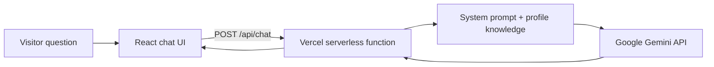

# Pratik Potdukhe · Portfolio

My personal website, with an AI assistant that answers questions about my projects, experience and skills.

**Live:** https://pratikpotdukhe.vercel.app

Instead of making visitors scroll through everything, the site lets them ask. A recruiter can type "What did he build at Capgemini?" or "Has he deployed an ML model?" and get a short answer grounded in my actual profile. Below the chat are my projects, experience and skills for anyone who prefers to read.

## How it works



- **One source of truth.** All content lives in `src/data/profile.ts`. The website renders from it, and `src/data/knowledge.ts` turns the same data into the knowledge the assistant answers from. Updating one file updates both.
- **Grounded answers.** The model is instructed to answer only from the profile, to speak about me in the third person, and to say it doesn't know (and point to my email) instead of guessing.
- **Server-side API key.** The Gemini key is only used inside the serverless function, never sent to the browser.
- **Basic guardrails.** The function only accepts POST requests, keeps the last 8 messages, caps message length, and limits the reply size.
- **Offline fallback.** If the API is unreachable, for example during local development, the chat falls back to pre-written answers so the site still works.

## Tech stack

| Part | Technology |
| --- | --- |
| Front end | React 18, TypeScript, Vite |
| Chat backend | Vercel serverless function (Node) |
| LLM | Google Gemini (`gemini-2.5-flash` by default) |
| Hosting | Vercel |

## Project structure

```
api/
  chat.ts            Serverless endpoint that calls Gemini
src/
  App.tsx            Page layout and chat UI
  index.css          Styles (light and dark themes)
  data/
    profile.ts       All site content: profile, projects, experience, skills
    knowledge.ts     Builds the system prompt and offline answers from profile.ts
public/              Static files (photo, CV)
```

## Running locally

Requires Node.js 18 or newer.

```bash
npm install
npm run dev
```

The site runs at http://localhost:5173. In this mode the chat uses the offline answers.

To test the real assistant locally, install the Vercel CLI and add your key:

```bash
npm i -g vercel
echo "GEMINI_API_KEY=your-key" > .env.local
vercel dev
```

A free Gemini API key is available from [Google AI Studio](https://aistudio.google.com). `.env.local` is ignored by git.

## Deploying

1. Import the repository on [Vercel](https://vercel.com) and choose the **Vite** preset.
2. Add the environment variable `GEMINI_API_KEY`. Optionally set `GEMINI_MODEL` to use a different Gemini model.
3. Deploy. Every push to `main` redeploys the site.

## Roadmap

- Replace full-context prompting with retrieval: chunk the project write-ups, embed them, and send only the most relevant chunks to the model
- Stream answers token by token
- Add rate limiting per visitor
- Add project screenshots and links to each project's repository

## Contact

- Email: pratikatpolimi@gmail.com
- LinkedIn: [pratik-potdukhe](https://www.linkedin.com/in/pratik-potdukhe/)
- GitHub: [pratikpotdukhe30](https://github.com/pratikpotdukhe30)